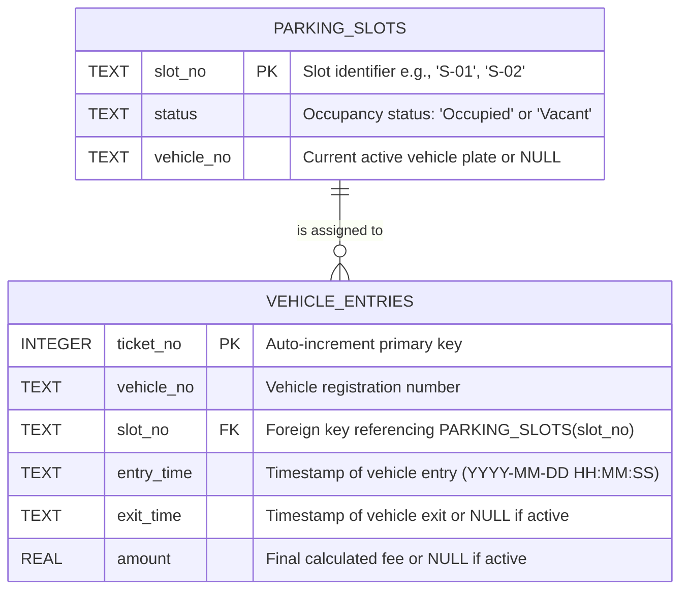

# Entity-Relationship (ER) Diagram & Database Design
**Park Wave - 4 Wheeler Smart Parking System (Bangalore)**

---

## 1. ER Diagram (Mermaid)



---

## 2. Table Specifications

### A. Table: `parking_slots`
Maintains the inventory and real-time state of physical parking bays.

| Column Name | Data Type | Constraints | Description |
| :--- | :--- | :--- | :--- |
| `slot_no` | `TEXT` | `PRIMARY KEY` | Unique slot identifier (e.g., `S-01`, `S-02`, ..., `S-20`). |
| `status` | `TEXT` | `NOT NULL`, `CHECK(status IN ('Occupied', 'Vacant'))` | Real-time occupancy status. |
| `vehicle_no` | `TEXT` | `DEFAULT NULL` | Plate number of the vehicle currently occupying the bay; `NULL` when vacant. |

---

### B. Table: `vehicle_entries`
Audit log and billing ledger recording all active and completed parking sessions.

| Column Name | Data Type | Constraints | Description |
| :--- | :--- | :--- | :--- |
| `ticket_no` | `INTEGER` | `PRIMARY KEY AUTOINCREMENT` | Unique sequential parking ticket number. |
| `vehicle_no` | `TEXT` | `NOT NULL` | Registration number plate of the vehicle (e.g., `KA 01 AB 1234`). |
| `slot_no` | `TEXT` | `NOT NULL`, `FOREIGN KEY` | References `parking_slots(slot_no)`. |
| `entry_time` | `TEXT` | `NOT NULL` | ISO formatted datetime string (`YYYY-MM-DD HH:MM:SS`). |
| `exit_time` | `TEXT` | `DEFAULT NULL` | Datetime when vehicle exited. `NULL` while currently parked. |
| `amount` | `REAL` | `DEFAULT NULL` | Total parking fee paid in INR (₹). `NULL` while currently parked. |

---

## 3. Relationships & Integrity Constraints

1. **Cardinality (1-to-Many / 1:N)**:
   - One `parking_slots` entry can be associated with multiple `vehicle_entries` over time as different vehicles occupy and vacate the bay.
   - Each `vehicle_entries` record references exactly one `parking_slots` record through `slot_no`.

2. **Foreign Key Enforcement**:
   - `FOREIGN KEY (slot_no) REFERENCES parking_slots(slot_no)`
   - Foreign key checks are strictly enabled at connection time via `PRAGMA foreign_keys = ON;`.

3. **Active Parking Uniqueness (Duplicate Prevention)**:
   - At any given point in time, a vehicle cannot have more than one active entry (`exit_time IS NULL`).
   - The application enforces this atomically before slot allocation:
     ```sql
     SELECT ticket_no FROM vehicle_entries 
     WHERE UPPER(vehicle_no) = ? AND exit_time IS NULL;
     ```
   - If an active entry exists, entry is refused with:
     > `"Invalid entry, the vehicle already exists"`

---

## 4. Lifecycle Data Flow

### A. Vehicle Entry Flow
```
[Vehicle Arrives]
       │
       ▼
[Enter Plate No]
       │
       ▼
[Duplicate Check in DB] ──(Already active)──► Refuse: "Invalid entry, the vehicle already exists"
       │
   (Not active)
       ▼
[Find Next Vacant Slot] ──(None available)──► Show: "Parking full: No vacant slots available"
       │
  (Slot found)
       ▼
[Atomic Transaction]
  ├─ UPDATE parking_slots SET status = 'Occupied', vehicle_no = ? WHERE slot_no = ?
  └─ INSERT INTO vehicle_entries (vehicle_no, slot_no, entry_time)
       │
       ▼
[Generate & Print Entry Pass]
```

### B. Vehicle Exit Flow
```
[Vehicle Exit / Checkout]
       │
       ▼
[Look Up Active Entry by Plate/Ticket] ──(Not Found)──► "Vehicle not found or not currently parked"
       │
    (Found)
       ▼
[Calculate Duration & Fee]
  ├─ Duration = Exit Time - Entry Time
  ├─ If Duration <= 1 hour: Amount = ₹50 (covers first 1 hour)
  └─ If Duration > 1 hour: Amount = ₹50 + (ceil(Duration_hours - 1) × ₹20)
       │
       ▼
[Atomic Transaction]
  ├─ UPDATE vehicle_entries SET exit_time = ?, amount = ? WHERE ticket_no = ?
  └─ UPDATE parking_slots SET status = 'Vacant', vehicle_no = NULL WHERE slot_no = ?
       │
       ▼
[Generate & Print Final Receipt / Tax Invoice]
```
